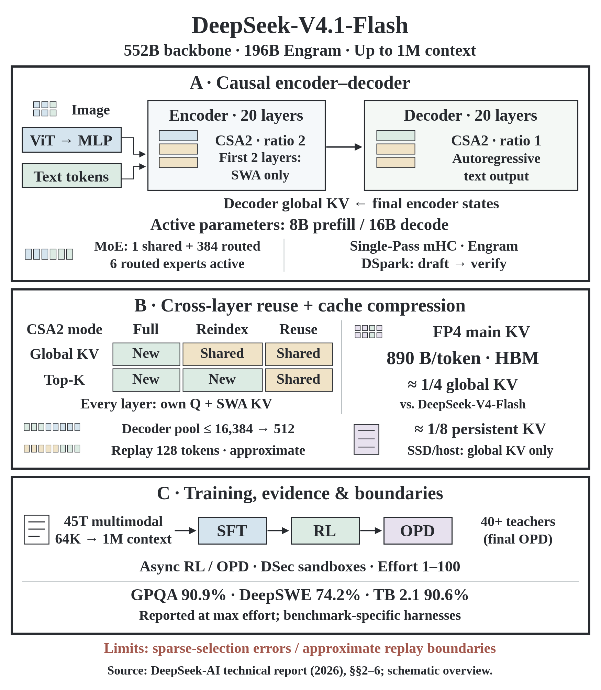
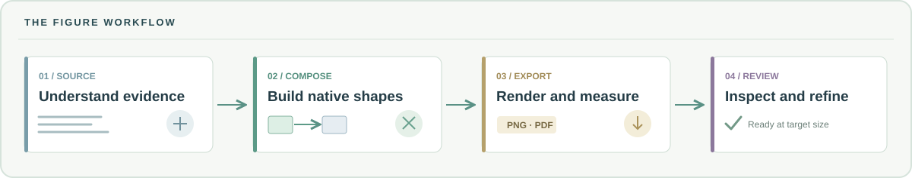

<h1 align="center">Draw.io Research Skill</h1>
<p align="center"><strong>Editable research figures. Compact layouts. Evidence before decoration.</strong></p>
<p align="center">
  <a href="LICENSE"></a>
  <a href=".github/workflows/check.yml"></a>
  <a href="examples/deepseek-v4.1-flash/overview.drawio"></a>
</p>
<p align="center">An agent skill for turning paper content into clear, carefully reviewed Draw.io schematics.</p>
<p align="center">
  <a href="#quick-start"><strong>Quick start</strong></a> ·
  <a href="#report-to-figure-example">Example</a> ·
  <a href="#documentation">Documentation</a> ·
  <a href="README.zh-CN.md">Chinese</a>
</p>

---

**Draw.io Research Skill** captures a practical workflow for academic architecture, method, challenge, and evaluation figures: understand the source, learn the reference style, compose meaningful native schematics, compress the layout, and inspect the exported result until material defects are resolved.

It is an instruction package for a capable agent, with optional validation tools. It is **not a rendering engine**, a collection of copied paper figures, or a guarantee that a first draft is publication-ready.

**English labels are the default**, regardless of the language used to discuss the task. An explicit user instruction can select another language.

## Report-to-figure example

### One autonomous run · Zero human design intervention

> [!IMPORTANT]
> **The figure below was completed in one end-to-end autonomous task.** After the report scope was clarified, Codex read the full report, composed the diagram, and reviewed and revised its exports **without human layout edits or intermediate design feedback**.

| Autonomous task | Human design interventions | Report pages read | Agent-internal render passes |
|:---:|:---:|:---:|:---:|
| **1** | **0** | **51** | **3** |

<p align="center">
  <a href="examples/deepseek-v4.1-flash/README.md"></a>
</p>

“One run” describes the complete autonomous task, including internal review and revision; it does not mean one model response or one render. The run inherited the skill-development context and is not an independent benchmark. **Codex generated the figure; DeepSeek is its subject.** See the [run record](examples/deepseek-v4.1-flash/run.json) for provenance.

[Editable source](examples/deepseek-v4.1-flash/overview.drawio) · [PDF](examples/deepseek-v4.1-flash/overview.pdf) · [Source mapping and provenance](examples/deepseek-v4.1-flash/README.md) · [Review record](examples/deepseek-v4.1-flash/review.md)

## What this skill does



| Capability | Practical outcome |
|---|---|
| Source-grounded composition | Claims, objects, outputs, and dependencies stay faithful to the manuscript |
| Reference-matched academic styling | Colors, typography, frames, and arrows follow the supplied visual reference |
| Real layout compression | Width and height are reduced by reorganizing content, not by hiding tiny text in a large preview |
| Meaningful schematic detail | PE arrays, tensors, queues, banks, reports, and device grids explain actual concepts |
| Native editability | Text, components, and connectors remain editable in `.drawio` |
| Export-based review | The workflow checks actual labels, frame contact, arrow visibility, and publication-scale readability |
| Controlled revisions | Approved figures remain protected while the requested variant is refined |

Best suited to architecture and circuit schematics, method overviews, challenge-to-method explanations, verification pipelines, and dense single-column research figures. For empirical charts, use a plotting workflow; for raster illustrations, use an image workflow.

## Quick start

### 1. Make the skill available

Download or clone this repository. Keep the complete folder: `SKILL.md` links to the references, templates, presets, and optional tools.

For Codex, from the repository root on a POSIX shell:

```bash
mkdir -p "${CODEX_HOME:-$HOME/.codex}/skills"
ln -s "$PWD" "${CODEX_HOME:-$HOME/.codex}/skills/drawio-research-skill"
```

Keep the checkout at that location so the link remains valid. If a skill already exists at the destination, inspect it before replacing it. Restart or refresh your agent's skill discovery as appropriate for the installed client. For other agents, use their documented skill installation mechanism, or explicitly ask the agent to read this repository's `SKILL.md`.

### 2. Provide content and constraints

A useful request includes the current manuscript or a precise content outline, any reference figures, the target publication dimensions, and the desired output path.

```text
Use $drawio-research-skill to create an editable research figure.

Content authority: the Method section of the supplied manuscript.
Visual reference: the figures in the supplied style directory.
Target: an 88 mm single-column figure with minimal necessary height.
Labels: English.
Deliverables: method.drawio, a PNG preview, and a PDF.

Preserve the scientific distinctions in the source. Use meaningful native
schematics, keep the layout compact, and inspect the exported result for
text/frame collisions, short arrows, and readability at publication size.
```

For an existing figure:

```text
Use $drawio-research-skill to reduce the width of method.drawio.
Keep all required content and protect the approved neighboring figures.
Repack groups and shorten redundant wording before reducing type size.
Rerender and review the final result; report the new physical dimensions.
```

### 3. Let the review loop finish

The intended workflow is:

1. Establish source authority and the figure's main message.
2. Extract visual tokens from references or choose a suitable preset.
3. Build the native schematic with an explicit reading order.
4. Compact the layout while preserving meaning and legibility.
5. Export, inspect, reject defects, and revise.
6. Deliver editable source and fresh exports with a short review record.

A missing renderer is a disclosed limitation, not a reason to claim that an unreviewed source is ready for publication.

## The quality contract

**Scientific correctness comes first.** No invented measurements, capabilities, tools, or causal relationships. An estimate must not look like physical confirmation; eligibility must not look like acceptance.

**Density must carry meaning.** Each pictogram explains a source-backed concept. Empty margins can be compressed; essential separation and connector corridors remain. Random circuit marks are not a remedy for whitespace.

**Small does not mean unreadable.** Validate the final dimensions and physical type size. Higher PNG resolution does not improve printed font size. Reorganize the content before shrinking the entire figure.

**Editability is a deliverable.** Keep the native source. Use separate tool symbols and editable names when suitable assets exist. Do not replace the figure with one flattened image.

**A passing script is not a visual review.** Inspect the actual output, including crowded areas and the intended publication size. Automated tools cover a documented subset of possible defects.

## Documentation

The entrypoint is deliberately concise. Detailed instructions are loaded only when relevant.

| Document | What it answers |
|---|---|
| [SKILL.md](SKILL.md) | How should an agent conduct the full task? |
| [Content and semantics](references/content-and-semantics.md) | What can be stated, abbreviated, or omitted? |
| [Academic style](references/academic-style.md) | How are paper styles, line weights, fonts, and physical sizes calibrated? |
| [Layout and compaction](references/layout-and-compaction.md) | How can a figure become narrower, shorter, and denser without losing meaning? |
| [Connectors](references/connectors.md) | How are visible shafts, endpoints, fan-out, and feedback paths kept clear? |
| [Semantic iconography](references/semantic-iconography.md) | Which small motifs are useful, and how are logos handled? |
| [Draw.io engineering](references/drawio-engineering.md) | How are native XML, groups, assets, and exports kept editable and reproducible? |
| [Export and review](references/export-and-review.md) | Which checks run, what do they prove, and when must a draft be rejected? |
| [Research patterns](references/research-patterns.md) | How can evaluation harnesses and challenge/method figures be expressed? |
| [Revision playbook](references/revision-playbook.md) | What concrete changes address recurring user feedback? |

The [circuit/architecture preset](assets/presets/circuit-academic.json) supplies muted colors and a line/type hierarchy. It is a starting point, not a universal mandate. The [figure brief](assets/templates/figure-brief.md) and [review report](assets/templates/review-report.md) keep requirements and validation explicit.

## Optional local tools

The skill can guide manual or agent-driven work without installing these helpers. Tool capabilities are deliberately separated:

| Tool | Requirements | Coverage |
|---|---|---|
| `audit_drawio.py` | Python 3, standard library | IDs, references, parent cycles, geometry, explicit workflow routes |
| `review_svg.mjs` | Node.js, Playwright + Chromium | Rendered text overlap, text/image overlap, axis-aligned rectangle border contact |
| `export_pdf.mjs` | Node.js, Playwright + Chromium | Physical-width PDF export from a rendered SVG |
| `artifact_manifest.py` | Python 3, standard library | Source/export hash recording and subsequent freshness verification |

An actual Draw.io renderer is required to turn `.drawio` into PNG/SVG. Draw.io Desktop or an available compatible exporter can fill that role. This repository does not bundle Draw.io, browser binaries, fonts, or a third-party CLI.

```bash
# Audit an existing figure; replace figure.drawio with your source path.
python3 scripts/audit_drawio.py figure.drawio --report geometry-audit.json

# Optional browser tools: install locally, then use an already rendered SVG.
npm install
npx playwright install chromium
node scripts/review_svg.mjs figure.drawio.svg --report render-audit.json
node scripts/export_pdf.mjs figure.drawio.svg --width-mm 88 --output figure.pdf
```

See [Export and review](references/export-and-review.md) for rendering alternatives, artifact pairing, and limitations. Review untrusted SVGs in an appropriately isolated environment: browser-based tools load their content and may resolve embedded references.

## Repository layout

```text
drawio-research-skill/
├── SKILL.md                 Agent entrypoint
├── README.md                Installation, use, and scope
├── README.zh-CN.md          Chinese translation
├── agents/openai.yaml       Optional Codex interface metadata
├── references/              Detailed working guidance
├── assets/
│   ├── presets/             Academic circuit style tokens
│   ├── templates/           Figure brief and review record
│   └── readme/              Original README artwork
├── scripts/                 Optional audit and export tools
├── examples/                Requested report overview and run provenance
├── tests/                   Structural-tool regression tests
├── .github/workflows/       Repository checks
├── ACKNOWLEDGMENTS.md        Sources, inspiration, and reuse boundaries
├── CONTRIBUTING.md          Contribution and review expectations
├── LICENSE                  Apache License 2.0
└── NOTICE                   Project attribution
```


## Limits and deliberate choices

- The skill relies on the agent's judgment and available rendering/viewing capabilities. It does not guarantee publication readiness automatically.
- Numerical spacing values are configurable starting points, not rules that override the user's venue or visual reference.
- The circuit preset is not appropriate for every research topic. Do not add hardware imagery to unrelated subjects.
- Structural audits cannot verify scientific claims or reconstruct every renderer-specific route. SVG checks do not inspect all possible path shapes, padding, or arrow visibility.
- No third-party paper figures, tool logos, or pretrained assets are distributed here. Asset reuse in future figures needs its own provenance and applicable permissions.
- The included report overview is an explicitly requested demonstration. It is original schematic artwork; the report PDF is not redistributed.

## Attribution and license

Released under the [Apache License 2.0](LICENSE), with project attribution in [NOTICE](NOTICE). When redistributing this work or derivatives, follow the license's requirements for license copies, applicable notices, and modification notices. Apache 2.0 does not require a prominent README credit or require private modifications to be published.

A visible acknowledgment is appreciated:

> Based on Draw.io Research Skill. See the original project's LICENSE and NOTICE for attribution and licensing information.

Add the original repository URL when sharing this statement. This is a recommended credit format, not an additional license restriction.

The workflow was informed by [JGraph's Draw.io skill](https://github.com/jgraph/drawio-mcp) and the [draw-io-cli diagram skill](https://github.com/BRBussy/draw-io-cli). Their useful ideas, local provenance, intentionally rejected defaults, and reuse boundaries are documented in [ACKNOWLEDGMENTS.md](ACKNOWLEDGMENTS.md). This repository does not claim affiliation with either project.

The README's presentation draws on the clear entrypoints and documentation structure of [Excalidraw](https://github.com/excalidraw/excalidraw) and [Mermaid](https://github.com/mermaid-js/mermaid); their wording, branding, and artwork are not copied.

## Contributing

See [CONTRIBUTING.md](CONTRIBUTING.md). Prefer a concrete failure case and a narrowly justified improvement over additional universal rules. Keep skill instructions, references, and code comments in English. The Chinese README is an explicitly maintained translation.
