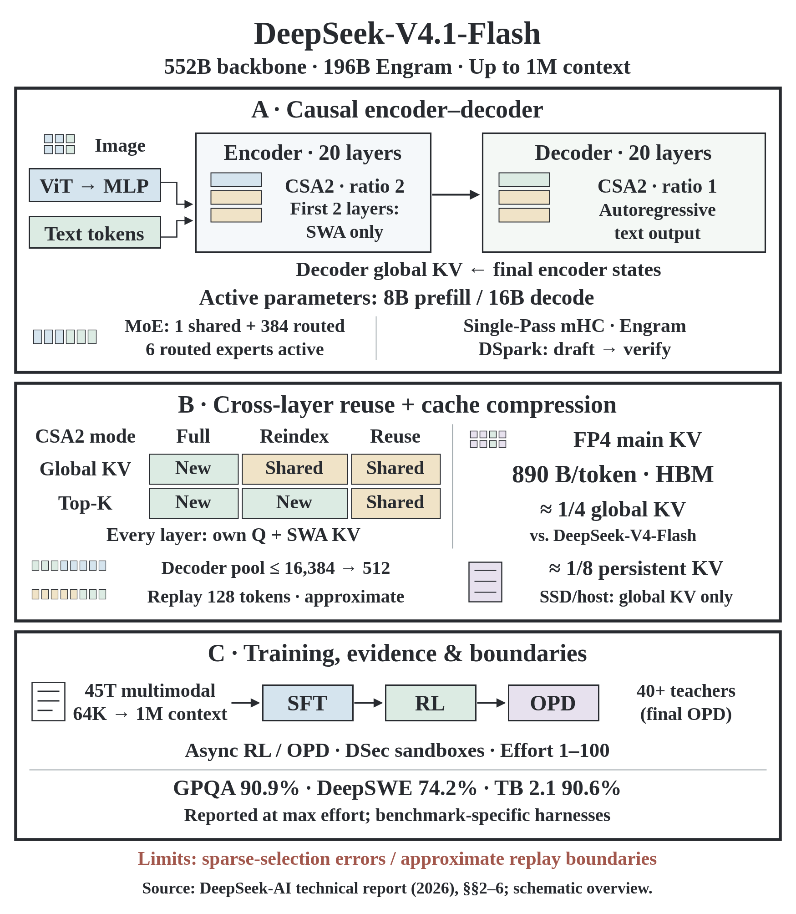
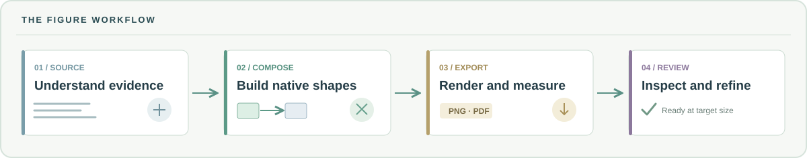

<h1 align="center">Draw.io Research Skill</h1>
<p align="center"><strong>可编辑的科研插图，紧凑的版式，有依据的图形表达。</strong></p>
<p align="center">
  <a href="LICENSE"></a>
  <a href=".github/workflows/check.yml"></a>
  <a href="examples/deepseek-v4.1-flash/overview.drawio"></a>
</p>
<p align="center">面向论文架构图、方法图和评测流程图的 agent skill。</p>
<p align="center">
  <a href="#快速开始"><strong>快速开始</strong></a> ·
  <a href="#绘图示例">示例</a> ·
  <a href="#详细文档">文档</a> ·
  <a href="README.md">English</a>
</p>

---

**Draw.io Research Skill** 将科研插图的完整工作流程整理为可复用技能：理解论文内容、提取参考风格、组织有实际意义的原生图形、压缩版式，并在导出后检查和修正问题。

它是一套供 agent 使用的指令和可选检查工具，**不是绘图渲染引擎，也不保证第一版就达到论文发表标准**。

**除非用户明确指定其他语言，图中标签默认使用英文。** 这一规则不受对话语言影响。skill、详细规范和代码注释使用英文；本文件是英文 README 的中文版本。

## 绘图示例

### 一次性自主完成 · 无人工设计干预

> [!IMPORTANT]
> **下图由一次完整的自主任务完成。** 确定报告范围后，Codex 阅读全文、组织内容、绘制图形，并自行导出、审查和修改，**全程没有人工修改布局，也没有中途人工设计反馈**。

| 完整自主任务 | 人工设计干预 | 全文阅读页数 | agent 内部渲染轮次 |
|:---:|:---:|:---:|:---:|
| **1 次** | **0 次** | **51 页** | **3 轮** |

<p align="center">
  <a href="examples/deepseek-v4.1-flash/README.md"></a>
</p>

“一次性”指一次完整自主任务，包含 agent 自行审校和修改，不表示只有一次模型响应或一次渲染。任务继承了此前的 skill 开发上下文，因此不是独立、全新上下文的性能测试。**绘制该图的是 Codex；DeepSeek 是图的研究对象。** 具体过程见[任务记录](examples/deepseek-v4.1-flash/run.json)。

[Draw.io 源文件](examples/deepseek-v4.1-flash/overview.drawio) · [PDF](examples/deepseek-v4.1-flash/overview.pdf) · [内容出处与过程记录](examples/deepseek-v4.1-flash/README.md) · [审校记录](examples/deepseek-v4.1-flash/review.md)

## 主要能力



| 能力 | 实际作用 |
|---|---|
| 忠实于来源 | 图中的主张、对象、产物和依赖关系能够追溯到原文 |
| 学习论文风格 | 根据参考图确定配色、字体、框线、箭头与图形语言 |
| 真正压缩布局 | 通过重排内容缩短宽高，而不是单纯把所有文字缩小 |
| 有意义的小图案 | 用 PE 阵列、张量、队列、存储银行、报告和器件网格解释实际概念 |
| 保持可编辑 | 文字、组件和连线保留为原生 `.drawio` 元素 |
| 导出后审校 | 检查文字重叠、文字贴框、箭头可见性和实际印刷尺寸下的可读性 |
| 控制修改范围 | 优化指定版本时保护已经确认的其他图片 |

适用于电路／架构图、方法概览、challenge–method 对应关系、验证评测流程，以及内容密集的单栏论文插图。实测数据图表应使用专门的绘图工具；照片或艺术插画应使用图像工作流。

## 快速开始

### 1. 安装或让 agent 读取 skill

下载或克隆本仓库，并保留完整目录。`SKILL.md` 会引用详细规范、模板、预设和可选工具，不建议只复制一个文件。

使用 Codex 时，在仓库根目录执行以下 POSIX shell 命令：

```bash
mkdir -p "${CODEX_HOME:-$HOME/.codex}/skills"
ln -s "$PWD" "${CODEX_HOME:-$HOME/.codex}/skills/drawio-research-skill"
```

符号链接依赖仓库位置，请勿随意移动目录。如果目标位置已经存在同名 skill，应先检查再决定是否替换。按照客户端的机制重启或刷新 skill 发现。

其他 agent 可以使用其支持的安装方式，也可以直接要求它阅读本仓库的 `SKILL.md`。

### 2. 给出内容、参考和尺寸

建议提供最新论文或准确的内容大纲、视觉参考、目标宽高和输出位置。例如：

```text
使用 $drawio-research-skill 绘制一张可编辑的科研插图。

内容依据：提供的论文 Method 部分。
视觉参考：style 目录中的论文配图。
尺寸：88 mm 单栏，保留可读性的前提下尽可能降低高度。
图中文字：英文。
交付：method.drawio、PNG 预览和 PDF。

保持原文的重要科学区别；使用有意义的原生小图案，紧凑排版。
导出后检查文字碰框、箭头过短和实际论文尺寸下的可读性。
```

修改已有图片时：

```text
使用 $drawio-research-skill 压缩 method.drawio 的宽度。
保留所有必要内容，不修改旁边已经确认的图片。
优先重排分组和精简重复文字，再考虑调整字号。
完成后重新导出、检查，并报告最终物理尺寸。
```

### 3. 完成审校闭环

1. 确认内容来源和图片最重要的信息。
2. 提取参考风格，或选择合适的预设。
3. 以明确的阅读顺序构建原生图形。
4. 在不改变含义的前提下压缩版式。
5. 导出、查看、驳回问题版本并修正。
6. 交付可编辑源文件、最新导出和简短审校记录。

如果没有可用渲染器，应明确说明源文件尚未经过视觉审校，不能直接声称已经达到可发表标准。

## 质量要求

**科学内容准确。** 不为了丰富版面而编造测量值、组件、工具或因果关系。“估计”不能画成“物理确认”，“恢复候选资格”不能画成“已经通过验证”。

**密度必须有意义。** 每个小图案都应解释一个有来源的概念。可以压缩空白边缘，但保留必要的视觉分隔和连线通道。随机电路线条不是填充空白的办法。

**小尺寸仍须可读。** 检查最终宽高和印刷字号，提高 PNG 分辨率不会让印刷文字变大。优先重组内容，再考虑整体缩放。

**可编辑是交付要求。** 保留 `.drawio` 源文件。适当情况下，工具符号和名称分开，名称使用可编辑文字。不能用一张整图截图代替原生图形。

**脚本通过不等于视觉合格。** 必须查看实际输出，包括最密集的区域和论文排版尺寸。自动检查仅覆盖明确说明的部分问题。

## 详细文档

主入口保持简洁，细节放在按任务读取的参考文档中。

| 文档 | 解决的问题 |
|---|---|
| [SKILL.md](SKILL.md) | agent 如何完成整个任务 |
| [内容与语义](references/content-and-semantics.md) | 哪些内容可以表述、缩写或删减 |
| [学术风格](references/academic-style.md) | 如何校准配色、线宽、字体与物理尺寸 |
| [布局与压缩](references/layout-and-compaction.md) | 如何在保留含义的前提下缩短宽高、提高密度 |
| [连线规范](references/connectors.md) | 如何保证箭杆、端点、分支和反馈线清晰 |
| [有意义的图案](references/semantic-iconography.md) | 小图案如何表达概念，工具图标如何处理 |
| [Draw.io 工程细节](references/drawio-engineering.md) | 如何维护原生 XML、分组、素材与导出 |
| [导出与审校](references/export-and-review.md) | 如何检查、检查覆盖什么、何时必须返工 |
| [科研图表达模式](references/research-patterns.md) | 评测 harness 和 challenge–method 图如何组织 |
| [修改经验](references/revision-playbook.md) | 如何把常见反馈转成具体可验证的修改 |

[电路／架构图预设](assets/presets/circuit-academic.json) 提供柔和配色及线宽、字号层级，是起点而非统一强制标准。[绘图需求模板](assets/templates/figure-brief.md) 和[审校模板](assets/templates/review-report.md) 用于记录要求与验证结果。

## 可选本地工具

skill 本身可以指导手工或 agent 绘图；以下工具用于辅助检查：

| 工具 | 环境要求 | 检查范围 |
|---|---|---|
| `audit_drawio.py` | Python 3 标准库 | ID、引用、父级循环、几何及显式主流程路径 |
| `review_svg.mjs` | Node.js、Playwright 与 Chromium | 导出文字重叠、文字与图标重叠、文字碰矩形框线 |
| `export_pdf.mjs` | Node.js、Playwright 与 Chromium | 根据指定物理宽度将已渲染 SVG 导出为 PDF |
| `artifact_manifest.py` | Python 3 标准库 | 记录并验证源文件与导出文件的哈希 |

将 `.drawio` 渲染为 PNG/SVG 仍需要真正的 Draw.io 渲染器，例如 Draw.io Desktop 或已有的兼容导出工具。本仓库不附带 Draw.io、浏览器二进制、字体或第三方 CLI。

```bash
python3 scripts/audit_drawio.py figure.drawio --report geometry-audit.json

npm install
npx playwright install chromium
node scripts/review_svg.mjs figure.drawio.svg --report render-audit.json
node scripts/export_pdf.mjs figure.drawio.svg --width-mm 88 --output figure.pdf
```

完整命令、配对检查和能力边界见[导出与审校](references/export-and-review.md)。浏览器工具会加载 SVG 内容和其中的引用；不可信文件应在适当隔离的环境中处理。

## 仓库结构

```text
drawio-research-skill/
├── SKILL.md                 agent 主入口
├── README.md                英文说明
├── README.zh-CN.md          中文说明
├── agents/openai.yaml       Codex 界面元信息
├── references/              详细规范
├── assets/
│   ├── presets/             科研风格预设
│   ├── templates/           需求、素材与审校模板
│   └── readme/              原创 README 图形
├── scripts/                 可选检查与导出工具
├── examples/                指定报告示例与过程记录
├── tests/                   工具回归测试
├── .github/workflows/       仓库检查
├── ACKNOWLEDGMENTS.md        参考来源与复用边界
├── CONTRIBUTING.md          贡献说明
├── LICENSE                  Apache License 2.0
└── NOTICE                   项目署名
```


## 能力边界

- 效果依赖 agent 的判断以及实际可用的渲染、查看工具，不自动保证论文发表质量。
- 间距数值是可调整的初始值，不能凌驾于用户要求、期刊规范或参考图之上。
- 电路风格不适合所有研究主题，不应给无关主题强加硬件图案。
- 结构检查不能验证科学结论，也不能还原所有渲染器专属路径；SVG 检查不覆盖所有路径、留白和箭头可见性。
- 本仓库没有搬运论文原图或官方软件 logo；未来添加第三方素材需单独记录来源和使用条件。
- DeepSeek 报告示例由用户明确指定，使用原创原生图形；下载的报告 PDF 不作为仓库资产再分发。

## 来源与许可证

本项目采用 [Apache License 2.0](LICENSE)，项目署名见 [NOTICE](NOTICE)。再分发本项目或衍生版本时，应遵守许可证关于保留许可、适用声明和修改说明的要求。Apache 2.0 不强制在 README 首页显著署名，也不要求公开私下的修改。

欢迎使用以下来源说明，并在分享时补充原仓库链接：

> Based on Draw.io Research Skill. See the original project's LICENSE and NOTICE for attribution and licensing information.

这只是推荐引用格式，不是额外的许可证限制。

我们参考了 [JGraph 的 Draw.io skill](https://github.com/jgraph/drawio-mcp) 和 [draw-io-cli 的 diagram skill](https://github.com/BRBussy/draw-io-cli)。参考了哪些经验、哪些默认规则不适用，以及为何没有直接搬运许可证不明确的内容，均见 [ACKNOWLEDGMENTS.md](ACKNOWLEDGMENTS.md)。本项目不代表这些上游项目。

README 的入口导航和文档组织参考了 [Excalidraw](https://github.com/excalidraw/excalidraw) 与 [Mermaid](https://github.com/mermaid-js/mermaid)，没有复制其文案、品牌或图像。

## 参与贡献

参阅 [CONTRIBUTING.md](CONTRIBUTING.md)。优先提交具体失败案例和针对性的改进，避免不断堆积不适用的通用规则。skill、规范和代码保持英文，中英文 README 保持同步。
