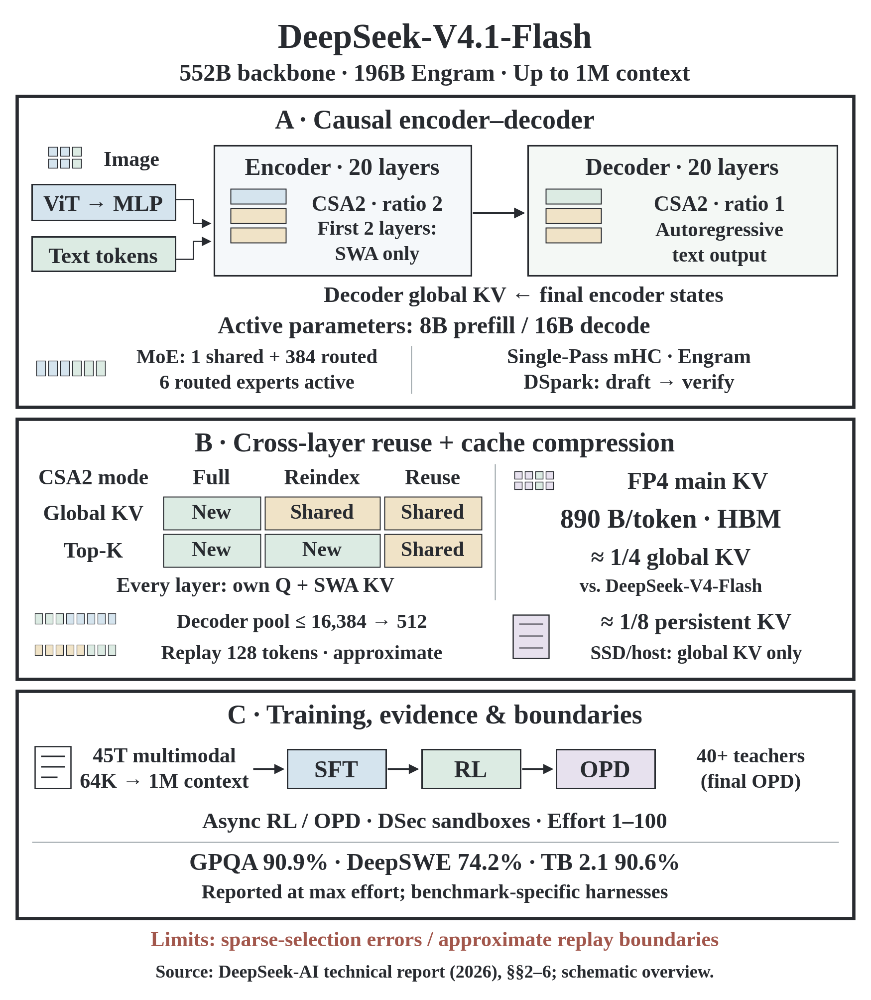

# DeepSeek-V4.1-Flash report overview

[Editable Draw.io](overview.drawio) · [PNG](overview.drawio.png) · [SVG](overview.drawio.svg) · [PDF](overview.pdf) · [Review record](review.md)

> [!IMPORTANT]
> **One autonomous run. Zero human design intervention.** After scope clarification, the agent completed source reading, drawing, and export review without human layout edits or intermediate design feedback. The task included **three internal render passes**.



## Generation provenance

This example was produced by Codex in **one autonomous task, with no human layout edits or intermediate design feedback after the report scope was clarified**. The agent performed its own source reading, composition, export checks, and revisions. This is not a claim of one model response, one renderer invocation, or an independent benchmark of the skill. The task inherited the preceding skill-development conversation.

DeepSeek-V4.1-Flash is the subject of the figure, not the model used to generate it. No DeepSeek API inference was used.

The complete 51-page report was downloaded from the official DeepSeek-AI model repository and read, including appendices. The figure is a selective overview, not an attempt to reproduce every result, equation, or implementation detail. The native shapes and layout are original; no paper artwork or product logo is embedded.

## Source

- DeepSeek-AI. *DeepSeek-V4.1-Flash: Pushing the Limits of KV Cache Compression* (2026).
- [Official report PDF](https://huggingface.co/deepseek-ai/DeepSeek-V4.1-Flash/resolve/main/DeepSeek_V41_Tech_Report.pdf)
- [arXiv record](https://arxiv.org/abs/2609.19969)
- PDF SHA-256: `ba68e2e40408125ae6d2f63a9a241b61c73910691c74ec1a2a7023c851eac08d`
- Retrieval date: 2026-11-18.

The local downloaded report is kept under the gitignored `work/deepseek-v4.1-flash/` directory; it is not redistributed as an Apache-licensed repository asset.

## Traceability

| Figure content | Report location | Qualification preserved |
|---|---|---|
| Backbone, Engram, context, encoder/decoder and active parameters | §§2.1–2.2, 4.2.1; pp. 7–9, 21–22 | Backbone and Engram counts are separate; prefill and decode differ |
| MoE, mHC, Engram, DSpark | §§2.4, 4.2.1; pp. 12–14, 22 | Motif cell counts are schematic |
| CSA2 mode table and candidate pool | §2.3; pp. 9–12 | Full, Reindex and Reuse are modes, not sequential processing stages |
| Main KV precision and HBM footprint | §2.4.4 and §6; pp. 14, 37 | 890 bytes/token describes global KV, not model weights |
| Replay and persistent cache | §§3.2.1–3.2.2; pp. 19–20 | Replay is approximate; the 1/8 ratio uses V4-Flash as baseline |
| Pretraining, SFT/RL/OPD, teachers and DSec | §§4–5; pp. 20–32 | This is a pipeline overview, not a novel optimization algorithm claim |
| Selected evaluation values | Table 3 and §5.3.1; pp. 32–33 | Reported results, maximum effort, benchmark-specific harnesses |
| Robustness boundaries | §6; p. 37 | Sparse selection and approximate replay can fail in untested cases |

GPQA means GPQA Diamond (Pass@1); DeepSWE means DeepSWE v1.1 (Resolved); TB 2.1 means Terminal-Bench 2.1 (Pass@1). The two cache ratios are approximate and relative to DeepSeek-V4-Flash, under the report's comparable conditions. The overview does not represent rerun benchmark results.

## Reproduce the source

```bash
python3 examples/deepseek-v4.1-flash/build.py
python3 scripts/audit_drawio.py examples/deepseek-v4.1-flash/overview.drawio
```

Render with an available Draw.io exporter, then follow [the export workflow](../../references/export-and-review.md). Source regeneration is deterministic. Export appearance can depend on renderer and installed fonts.
